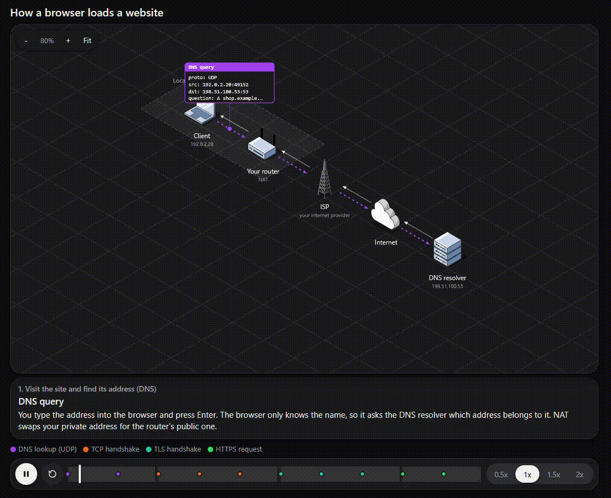

# packetplay

**Describe how something travels. Get an animated diagram you can play, pause and zoom.**



packetplay turns a small YAML or JSON file into **one self-contained HTML page**. Packets hop from
node to node along the links, each one showing the data it carries. Use it to explain a DNS lookup,
a TCP and TLS handshake, how a file becomes bits, a home network, or a WebRTC call. The page needs no
server, no internet and no libraries: open it in any browser, or send it to someone.

> **Use it with AI.** packetplay ships as a **Claude Code skill and plugin**. Ask in plain words, for
> example *"Make an animated diagram of how a request goes from my laptop through DNS to a web
> server"*, and Claude writes the scene, checks it and builds the page.
> [Install it in two commands](#use-it-with-claude-skill-and-plugin).

## What you get

- **Moving packets with data.** Every packet has a header (the step label) and up to four
  `key: value` rows. A node can rewrite the data on the way, for example NAT changing a source address.
- **A 3D isometric grid.** Zoom with the wheel or a pinch, pan with a drag. Every link is two arrows, one per direction.
- **Chapters and steps.** A caption explains each step. A clickable timeline, play and pause, restart, and speeds from 0.5x to 2x.
- **Streams and replies.** Flow steps show streams of tiny packets. `both: true` sends a reply back the other way.
- **Storytelling helpers.** A node can stay hidden until a step reveals it (the web server appears only
  after the DNS answer), and a step can show text being typed before it is sent.
- **Groups.** Draw a box around nodes, for example "Local network" or "Kernel".
- **YAML or JSON.** The same model, checked by one JSON Schema with clear error messages.

## Quick start

You need [Bun](https://bun.sh).

```
git clone https://github.com/nokri-mohammed/packetplay.git
cd packetplay
bun install
bun run build:examples      # writes dist/*.html, open any of them in a browser
```

Build your own scene:

```
bun run src/cli.ts build my.scene.yaml -o my.html
```

## Use it with Claude (skill and plugin)

The folder `skills/packetplay/` is a Claude Code skill: instructions, example scenes and the whole
tool as **one file** (`packetplay.js`). It needs only Bun. No clone, no `bun install`, no internet.

**Install as a plugin (recommended).** This repository is its own plugin marketplace. In any project:

```
/plugin marketplace add nokri-mohammed/packetplay
/plugin install packetplay@packetplay
```

Then just ask:

> Make an animated diagram of how DNS resolves a name.

Claude writes `dns.scene.yaml`, validates it, fixes any problem it finds, and builds `dns.html` next
to it. Updates arrive with `/plugin update`.

**Install by hand.** Link or copy the skill folder yourself:

```
ln -s <path to this repo>/skills/packetplay ~/.claude/skills/packetplay
```

Or copy it into one project's `.claude/skills/`. After you change the tool, run `bun run build:skill`
to rebuild the single file. A symlink follows the rebuild.

**Without Claude.** The single file also works on its own, with only Bun installed:

```
bun skills/packetplay/packetplay.js build my.scene.yaml -o my.html
```

## A scene in 30 seconds

```yaml
# yaml-language-server: $schema=https://raw.githubusercontent.com/nokri-mohammed/packetplay/main/schema/scene.schema.json
version: 1
title: How a WebRTC call connects
nodes:
  client: { label: Your laptop, icon: laptop }
  net:    { label: Internet,    icon: cloud }
  sig:    { label: call.example.com, icon: server, sub: signaling }
links:
  - [client, net]
  - [net, sig]
tracks:
  signal: { label: Signaling, color: blue }
chapters:
  - title: 1. Join the room
    steps:
      - from: client
        to: sig
        track: signal
        label: join room 42
        desc: The browser asks the signaling server to join the room.
        data: { room: "42" }
```

| Part | What it is |
|---|---|
| `nodes` | The boxes: an `icon` (45 built in), a `label`, an optional `sub` line, an optional `at: [i, j]` position and `group`. |
| `links` | Which nodes are connected. A step finds its own route across them. |
| `tracks` | Colours and names for kinds of traffic. |
| `chapters` and `steps` | The story. A step sends a message `from` a node `to` a node, with a `label`, a `desc` and `data`. |

Without `at`, nodes are laid out automatically. Add `at` when you want to draw the picture yourself.

## Examples

Five examples ship, each as YAML and as JSON, and each is also a good pattern to copy.

| Example | Shows | Good for learning |
|---|---|---|
| [udp](examples/udp.scene.yaml) | One UDP message, NAT rewriting the address, then a stream of datagrams | The smallest scene |
| [website](examples/website.scene.yaml) | A browser typing an address, then DNS, TCP handshake, TLS handshake and HTTPS | Typing, hidden nodes, groups, NAT |
| [osi](examples/osi.scene.yaml) | A 4000-byte file going from browser to kernel to network card as bits, then back up | Groups and layers |
| [homenet](examples/homenet.scene.yaml) | A home network with two switches and one router, 14 nodes | Hand-placed layouts, parallel flows |
| [webrtc](examples/webrtc.scene.yaml) | How a WebRTC call connects | Flows and several chapters |

## Command line

```
bun run src/cli.ts build <file> -o <out.html>   # scene to one HTML page
bun run src/cli.ts validate <file> [--json]     # check a scene, write no HTML
bun run src/cli.ts convert <file> --to json|yaml
bun run src/cli.ts export <file> -o <out.mp4|out.gif>   # render a video or GIF
bun run src/cli.ts icons                         # list the icon names
```

`export` is optional and needs a local Chrome and `ffmpeg` on your machine (nothing is bundled and no
npm browser package is needed). The lightest install is chrome-headless-shell; Chrome and Chromium work too. It seeks the page frame by frame, so the result is deterministic. Controls and zoom pills
are hidden; the title, caption and legend stay. Options: `--format mp4|gif` (from the file extension
by default), `--fps` (30, GIF 15), `--speed` (1), `--width` (1280, height is 16:9), `--from` and
`--to` in seconds of scene time, `--scale` for device pixel ratio (1). Chrome is found through
`CHROME_PATH`, then `chrome-headless-shell` (PATH, then `~/.cache/ms-playwright/chromium_headless_shell-*`),
then `google-chrome`, `chromium`, `chromium-browser`, then `~/.cache/ms-playwright/chromium-*`. MP4 is H.264 `yuv420p`; GIF uses a two-pass palette and loops.

`validate` prints `ok: <title> (N nodes, M steps)` and exits 0, or prints each problem and exits 1.
With `--json` (on `validate` and `build`) the result is one JSON object:
`{ "ok": true, "title": "...", "nodes": 4, "steps": 3 }` or
`{ "ok": false, "issues": [ { "message": "...", "path": "..." } ] }`.

Playback keys: Space play or pause, Left and Right hop, N and P message, `[` and `]` chapter,
`+` and `-` speed, Home restart.

## Scene versions

A scene can say which schema it is written for with an optional top-level `version` (an integer, 1 or
higher). A missing `version` means 1. Optional additions do not bump it. A breaking change bumps it and
adds a new schema folder (`schema/v2/`), while `schema/scene.schema.json` stays as version 1. A scene
with a newer version than the tool understands fails with:

```
scene version 2 is not supported: this packetplay understands version 1 and older (update packetplay)
```

## Releases

Releases are automatic from [Conventional Commits](https://www.conventionalcommits.org). A GitHub
Action (release-please) keeps one release pull request open on `main`, holding the next version and the
generated [CHANGELOG.md](CHANGELOG.md). Merging that pull request creates the git tag and the GitHub
release. Before 1.0, `feat` bumps the minor number, `fix` the patch number, and a breaking change
(`feat!:` or a `BREAKING CHANGE:` footer) also bumps the minor number. To force a version, add a
`Release-As: x.y.z` footer to a commit message. The package is marked private, so nothing is published
to npm. The tool version is separate from the scene version above.

## Development

```
bun test              # all tests
bun run typecheck
bun run build:skill   # rebuild skills/packetplay/packetplay.js after changing src/
```

Built with Bun and TypeScript on top of [anime.js](https://animejs.com). See the
[design plan](docs/plans/2026-11-14-packetplay.md).

## License

[MIT](LICENSE).

## Credits

- [anime.js](https://github.com/juliangarnier/anime) v4, MIT, the animation engine.
- Icons in `icons/isoflow/`: the isoflow collection from
  [markmanx/isopacks](https://github.com/markmanx/isopacks) at commit
  `ab717516031a384d478f456e2a95fd276aa56353`, MIT, Copyright 2023 Mark Mankarious.
- The controls take their look from [Plush UI](https://plush-ui.pages.dev) (MIT), ported to plain CSS.
