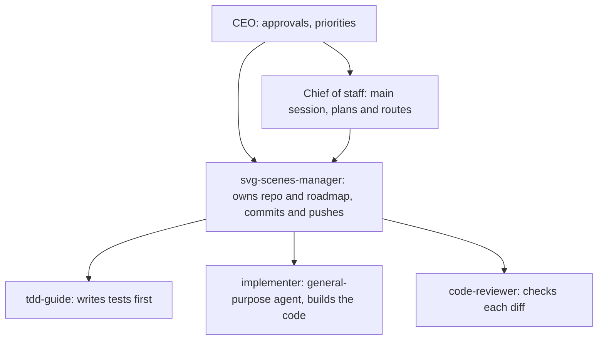

# Team: svg-scenes

## Involvement log

| Date | Who | What |
|---|---|---|
| 2026-11-14 | background agent | Project scaffolded (T-20261114-8): public repo, manager, design plan, WebRTC example, isoflow icons. |
| 2026-11-14 | svg-scenes-manager | CEO approved the design plan. Wrote M1 tickets T-20261114-1 to 5 (toolchain and schema, tests, loader and validator, router, review). |
| 2026-11-14 | general-purpose (sonnet) | T-20261114-1 done: Bun and TypeScript toolchain, JSON Schema, generated types, 6 tests. Manager re-ran tests, typecheck, gen:types idempotence and the public check. |
| 2026-11-14 | general-purpose (sonnet), acting as tdd-guide | T-20261114-2 done: 40 failing M1 tests for loader, validator and router (tdd-guide is not installed in this session). |
| 2026-11-14 | general-purpose (sonnet) x2 | T-20261114-3 (loader, validator) and T-20261114-4 (router) done in parallel. Manager added `allowImportingTsExtensions` to tsconfig. Full suite: 48 pass. |
| 2026-11-14 | general-purpose (sonnet), acting as code-reviewer | T-20261114-5 done: review of the M1 diff, no high findings, one medium (duplicated routing). |
| 2026-11-14 | general-purpose (sonnet) | T-20261114-6 done: validator now uses `routeStep`, stricter Ajv, empty-file error, stronger tests. Manager re-ran the suite and read the diff. Full suite: 56 pass. M1 complete. |
| 2026-11-14 | svg-scenes-manager | CEO said "go" for M2. Wrote tickets T-20261114-7 to 11 (tests, layout, icons, render, review). Layout and icons run in parallel, render waits for both. |
| 2026-11-14 | general-purpose (sonnet), acting as tdd-guide | T-20261114-7 done: M2 tests for layout, icons, render. Manager fixed two test bugs (icon count 37, fractional canvas height 720); a sonnet agent fixed strict typing in the tests. |
| 2026-11-14 | general-purpose (sonnet) x2 | T-20261114-8 (layout) and T-20261114-9 (icon loader, `prefixIds` helper) done in parallel. 104 tests pass, only render is red. |
| 2026-11-14 | general-purpose (sonnet) | T-20261114-10 done: static SVG renderer and `bun run render:example`. Manager re-ran tests, typecheck and parsed `dist/webrtc.svg`. 126 tests pass. |
| 2026-11-14 | general-purpose (sonnet), acting as code-reviewer | T-20261114-11 done: M2 review, no medium or higher findings, three small fixes ticketed. |
| 2026-11-14 | general-purpose (sonnet) | T-20261114-12 done: `at` minimum, illegal XML character stripping, script cleanup. 135 tests pass. |
| 2026-11-14 | svg-scenes-manager | CEO: "I want to test it, do not spend tokens on a tester". Stopped the M3 test-writing agent (T-20261114-13 cancelled, kept as design spec). M3 and M4 merged into one implementation ticket, T-20261114-14. No tester or reviewer agents from here. |
| 2026-11-14 | general-purpose (sonnet) | T-20261114-14 done: timeline compiler, player core, anime.js player, page builder, CLI (`build`, `convert`), colour validation. Manager re-ran tests (139 pass), typecheck, build (63 KB, no external requests). Not yet tried in a browser: the CEO tests by hand. |
| 2026-11-14 | svg-scenes-manager | Received two CEO design changes via the homelab-team session (isometric grid background with zoom and pan, two-arrow links). Added them to the plan as proposed, awaiting CEO confirmation. No code changed. |
| 2026-11-14 | svg-scenes-manager | CEO approved both design changes ("good start"). Plan marked approved. Wrote T-20261114-15 (isometric grid, zoom and pan, two-lane links), one rework ticket, no tester. |
| 2026-11-14 | general-purpose (sonnet) | T-20261114-15 done: isometric grid background with wheel zoom, drag pan, pinch and Fit; every link drawn as two arrows; `grid: iso \| none`; new `src/lanes.ts`. Manager re-ran tests (156 pass), typecheck, build (78 KB, 12 lanes, no external requests). Not tried in a browser: the CEO tests by hand. |
| 2026-11-14 | general-purpose (sonnet) | T-20261114-16 done: slower 1x (hop 1.6 s) and a 0.9 s rest at every node; also fixed the packet position lookup during rests. Manager re-ran tests (158 pass), typecheck, build. Example runs 69.6 s at 1x. |
| 2026-11-14 | general-purpose (sonnet) | T-20261114-17 done: packets show the step label and data rows (NAT rewrites visible), tiny packets for flow, new UDP example (YAML and JSON), `build:examples`. Manager re-ran tests (170 pass), typecheck, both builds. Not tried in a browser. |
| 2026-11-14 | general-purpose (sonnet) | T-20261114-18 done: packet info box floats above a dot on the lane (balloon), so it no longer covers icons. Manager re-ran tests (175 pass), typecheck, builds. |
| 2026-11-14 | general-purpose (sonnet) | T-20261114-19 done: website example (DNS, TCP handshake, TLS handshake, HTTPS request), 10 steps, 80.4 s at 1x. Manager re-ran tests (177 pass), typecheck, all three builds. |
| 2026-11-14 | manager (inline, no agent) | CEO: 'speed up slightly the 1x'. Constants only: hop 1.3 s, rest 0.75 s, flow 5 s, gap 0.5 s, pulse 0.75 s (about 18 percent faster). WebRTC 57.2 s, UDP 18.3 s, website 66 s at 1x. Tests updated by hand, 177 pass. |
