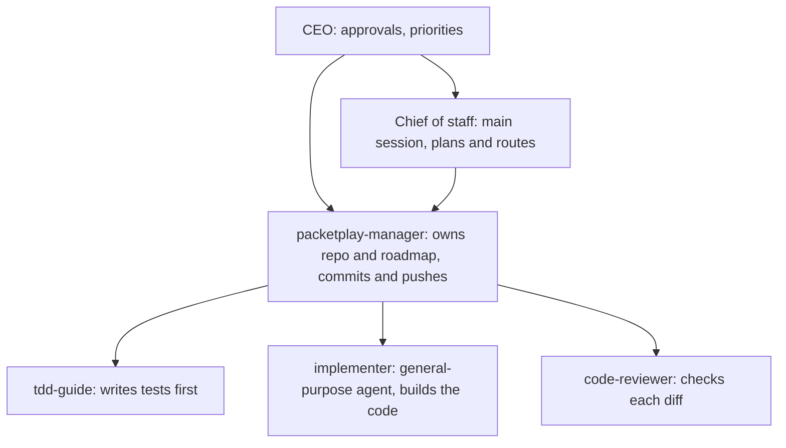

# Team: packetplay

## Involvement log

| Date | Who | What |
|---|---|---|
| 2026-11-14 | background agent | Project scaffolded (T-20261114-8): public repo, manager, design plan, WebRTC example, isoflow icons. |
| 2026-11-14 | packetplay-manager | CEO approved the design plan. Wrote M1 tickets T-20261114-1 to 5 (toolchain and schema, tests, loader and validator, router, review). |
| 2026-11-14 | general-purpose (sonnet) | T-20261114-1 done: Bun and TypeScript toolchain, JSON Schema, generated types, 6 tests. Manager re-ran tests, typecheck, gen:types idempotence and the public check. |
| 2026-11-14 | general-purpose (sonnet), acting as tdd-guide | T-20261114-2 done: 40 failing M1 tests for loader, validator and router (tdd-guide is not installed in this session). |
| 2026-11-14 | general-purpose (sonnet) x2 | T-20261114-3 (loader, validator) and T-20261114-4 (router) done in parallel. Manager added `allowImportingTsExtensions` to tsconfig. Full suite: 48 pass. |
| 2026-11-14 | general-purpose (sonnet), acting as code-reviewer | T-20261114-5 done: review of the M1 diff, no high findings, one medium (duplicated routing). |
| 2026-11-14 | general-purpose (sonnet) | T-20261114-6 done: validator now uses `routeStep`, stricter Ajv, empty-file error, stronger tests. Manager re-ran the suite and read the diff. Full suite: 56 pass. M1 complete. |
| 2026-11-14 | packetplay-manager | CEO said "go" for M2. Wrote tickets T-20261114-7 to 11 (tests, layout, icons, render, review). Layout and icons run in parallel, render waits for both. |
| 2026-11-14 | general-purpose (sonnet), acting as tdd-guide | T-20261114-7 done: M2 tests for layout, icons, render. Manager fixed two test bugs (icon count 37, fractional canvas height 720); a sonnet agent fixed strict typing in the tests. |
| 2026-11-14 | general-purpose (sonnet) x2 | T-20261114-8 (layout) and T-20261114-9 (icon loader, `prefixIds` helper) done in parallel. 104 tests pass, only render is red. |
| 2026-11-14 | general-purpose (sonnet) | T-20261114-10 done: static SVG renderer and `bun run render:example`. Manager re-ran tests, typecheck and parsed `dist/webrtc.svg`. 126 tests pass. |
| 2026-11-14 | general-purpose (sonnet), acting as code-reviewer | T-20261114-11 done: M2 review, no medium or higher findings, three small fixes ticketed. |
| 2026-11-14 | general-purpose (sonnet) | T-20261114-12 done: `at` minimum, illegal XML character stripping, script cleanup. 135 tests pass. |
| 2026-11-14 | packetplay-manager | CEO: "I want to test it, do not spend tokens on a tester". Stopped the M3 test-writing agent (T-20261114-13 cancelled, kept as design spec). M3 and M4 merged into one implementation ticket, T-20261114-14. No tester or reviewer agents from here. |
| 2026-11-14 | general-purpose (sonnet) | T-20261114-14 done: timeline compiler, player core, anime.js player, page builder, CLI (`build`, `convert`), colour validation. Manager re-ran tests (139 pass), typecheck, build (63 KB, no external requests). Not yet tried in a browser: the CEO tests by hand. |
| 2026-11-14 | packetplay-manager | Received two CEO design changes via the homelab-team session (isometric grid background with zoom and pan, two-arrow links). Added them to the plan as proposed, awaiting CEO confirmation. No code changed. |
| 2026-11-14 | packetplay-manager | CEO approved both design changes ("good start"). Plan marked approved. Wrote T-20261114-15 (isometric grid, zoom and pan, two-lane links), one rework ticket, no tester. |
| 2026-11-14 | general-purpose (sonnet) | T-20261114-15 done: isometric grid background with wheel zoom, drag pan, pinch and Fit; every link drawn as two arrows; `grid: iso \| none`; new `src/lanes.ts`. Manager re-ran tests (156 pass), typecheck, build (78 KB, 12 lanes, no external requests). Not tried in a browser: the CEO tests by hand. |
| 2026-11-14 | general-purpose (sonnet) | T-20261114-16 done: slower 1x (hop 1.6 s) and a 0.9 s rest at every node; also fixed the packet position lookup during rests. Manager re-ran tests (158 pass), typecheck, build. Example runs 69.6 s at 1x. |
| 2026-11-14 | general-purpose (sonnet) | T-20261114-17 done: packets show the step label and data rows (NAT rewrites visible), tiny packets for flow, new UDP example (YAML and JSON), `build:examples`. Manager re-ran tests (170 pass), typecheck, both builds. Not tried in a browser. |
| 2026-11-14 | general-purpose (sonnet) | T-20261114-18 done: packet info box floats above a dot on the lane (balloon), so it no longer covers icons. Manager re-ran tests (175 pass), typecheck, builds. |
| 2026-11-14 | general-purpose (sonnet) | T-20261114-19 done: website example (DNS, TCP handshake, TLS handshake, HTTPS request), 10 steps, 80.4 s at 1x. Manager re-ran tests (177 pass), typecheck, all three builds. |
| 2026-11-14 | manager (inline, no agent) | CEO: 'speed up slightly the 1x'. Constants only: hop 1.3 s, rest 0.75 s, flow 5 s, gap 0.5 s, pulse 0.75 s (about 18 percent faster). WebRTC 57.2 s, UDP 18.3 s, website 66 s at 1x. Tests updated by hand, 177 pass. |
| 2026-11-14 | manager (inline, no agent) | CEO: website example should start with 'visit website'. Added node 'you' (user icon) and chapter 1 'You visit a website' (you to laptop, 1 hop); chapters renumbered. 5 chapters, 11 steps, 68.55 s at 1x. 177 pass. |
| 2026-11-14 | general-purpose (sonnet) | T-20261114-20 done: OSI example (7 layers, file down to bits, then back up), 12 steps, 30.1 s at 1x. Manager re-ran tests (179 pass), typecheck, check-public. |
| 2026-11-14 | general-purpose (sonnet) | T-20261114-21 done: OSI example reworked (browser, kernel, network card; user space, kernel, hardware groups; 3 segments of 4000 bytes), 8 steps, 19.9 s at 1x. Manager re-ran tests (179 pass), typecheck, check-public. |
| 2026-11-14 | general-purpose (sonnet) | T-20261114-22 done: animated dotted route highlight for every step, optional schema fields hidden (node) and reveal (step), website server appears when the DNS answer arrives (14.6 s). Manager re-ran tests (200 pass), typecheck, all four builds, check-public. |
| 2026-11-14 | general-purpose (sonnet) | T-20261114-23 done: the lane arrow itself is the highlight (coloured, dotted, flowing); packets travel edge to edge and jump to the far side of each icon. Manager re-ran tests (205 pass), typecheck, four builds, check-public. |
| 2026-11-14 | manager (inline, no agent) | CEO: arrowhead should be coloured too. Player clones the shared marker per track colour on first use and swaps marker-end while a step highlights the lane; restored afterwards. Static SVG unchanged. 205 pass. |
| 2026-11-14 | general-purpose (sonnet) | T-20261114-24 done: 1x about 15 percent faster (hop 1.1 s, rest 0.65 s), noticeable reveal (pop plus two rings), optional step field typing with an address-bar typing animation before the packet leaves. Manager re-ran tests (221 pass), typecheck, four builds, check-public. |
| 2026-11-14 | manager (inline, no agent) | CEO: remove the 'You' node, rename laptop to Client with an IP. Website example: node client (192.0.2.20), the typing animation now sits on the DNS query step, 4 chapters, 10 steps, 58.33 s at 1x, server reveal at 12.08 s. Tests updated by hand, 221 pass. |
| 2026-11-14 | general-purpose (sonnet) | T-20261114-25 done: icons shake when Enter flashes and when a packet arrives; the dot then shows on the far side of the icon. Manager re-ran tests (234 pass), typecheck, four builds, check-public. |
| 2026-11-14 | manager (inline, no agent) | CEO: not a shake, a slight bump. nodeShake is now one 6 px lift and settle over 450 ms (dy = -6 sin(pi u)); timing of the dot jump unchanged. 234 pass. |
| 2026-11-14 | manager (inline, no agent) | CEO: dot arrives at the node, disappears, node bumps, dot exits on the other side. frameAt now hides the dot for the 450 ms bump at nodes that have a next hop; it reappears at the far edge for the last 200 ms of the rest. Return packet of a both step follows the same rule. 233 pass. |
| 2026-11-14 | manager (inline, no agent) | CEO: no pause when the dot reappears, continuous. SHAKE_MS 450 to 650 (equals NODE_DWELL_MS): the dot is inside the icon for the whole bump and the next hop starts the moment it reappears. Timing totals unchanged. 233 pass. |
| 2026-11-14 | manager (inline, no agent) | CEO: bump only the icon, not title and IP. The bump translate now goes on the icon use element; the group keeps only the reveal pop scale. 233 pass. |
| 2026-11-14 | manager (inline, no agent) | CEO: add an ISP to the website example and box the local network. Node isp (tower) between router and Internet, group lan (client + router). 4 hops per step, 75.83 s at 1x, server reveal at 15.58 s. |
| 2026-11-14 | general-purpose (sonnet) | T-20261114-26 done: homenet example (14 nodes, two switch stars, 4 chapters, 27.1 s at 1x) and a list of schema and player gaps. Manager re-ran tests (235 pass), typecheck, five builds, check-public. |
| 2026-11-14 | general-purpose (sonnet) | T-20261114-27 done: packet speed constant on every arrow (HOP_SPEED 0.07 px/ms, min 350 ms, durMs per hop). Totals: webrtc 51.9 s, udp 15.6 s, website 75.0 s, osi 17.0 s, homenet 52.5 s. Manager re-ran tests (240 pass), typecheck, five builds, check-public. |
| 2026-11-14 | general-purpose (sonnet) | T-20261114-28 done: compact controls in a Plush UI look (ported to plain CSS, not the React components): round Play/Pause and Restart, 0.5/1/1.5/2x toggle group, nav buttons and hints removed (keys still work). Manager re-ran tests (242 pass), typecheck, five builds, check-public. |
| 2026-11-14 | general-purpose (sonnet) | T-20261114-29 done: schema versioning. Optional top-level version (integer, min 1, missing means 1), SCHEMA_VERSION 1 in src/version.ts, loader error for newer scenes, real raw GitHub $id, version: 1 in all examples, README Versioning section. Manager re-ran tests (252 pass), typecheck, five builds, check-public, CLI error and exit code. |
| 2026-11-14 | manager (inline, no agent) | CEO approved: rename svg-scenes to packetplay (repo, folder, manager agent, package, CLI, schema id) and rewrite public history (squashed the two commits that held a local path, one force-push). Backup branch kept locally until verified. 252 pass. |
| 2026-11-14 | general-purpose (sonnet) | T-20261114-30 done: Claude skill (skills/packetplay: SKILL.md, five example scenes, one-file tool packetplay.js 579725 bytes, byte-identical pages for all five examples), validate, --json and icons commands. Manager re-ran tests, typecheck, build:skill, outside-repo comparison. |
| 2026-11-14 | manager (inline, no agent) | CEO: use the plugin route. Added .claude-plugin/plugin.json and marketplace.json (the repo is its own marketplace), README install steps, manifest tests. MCP deferred (stdio would need no port; not wanted now). |
