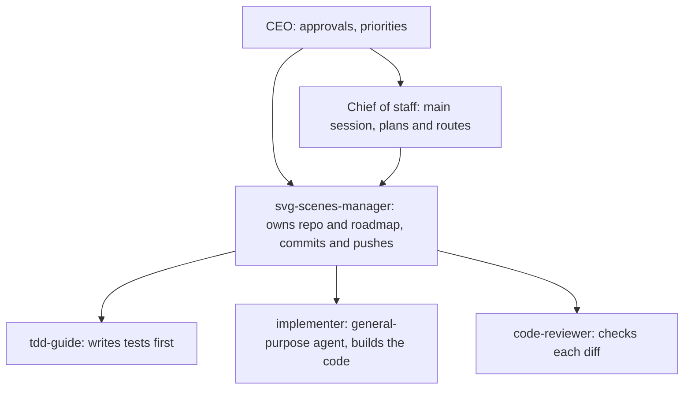

# Team: svg-scenes

## Involvement log

| Date | Who | What |
|---|---|---|
| 2026-11-14 | background agent | Project scaffolded (T-20261114-8): public repo, manager, design plan, WebRTC example, isoflow icons. |
| 2026-11-14 | svg-scenes-manager | CEO approved the design plan. Wrote M1 tickets T-20261114-1 to 5 (toolchain and schema, tests, loader and validator, router, review). |
| 2026-11-14 | general-purpose (sonnet) | T-20261114-1 done: Bun and TypeScript toolchain, JSON Schema, generated types, 6 tests. Manager re-ran tests, typecheck, gen:types idempotence and the public check. |
